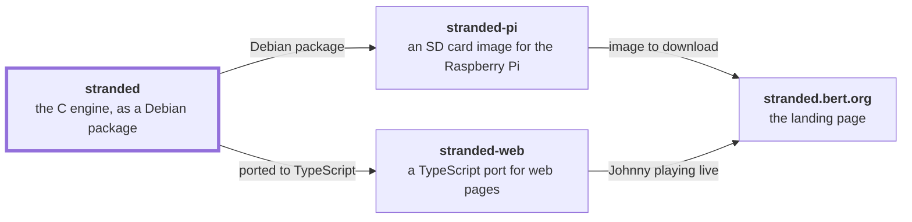

# Stranded

[stranded](https://github.com/bertrandom/stranded) · [stranded-pi](https://github.com/bertrandom/stranded-pi) · [stranded-web](https://github.com/bertrandom/stranded-web) · [stranded.bert.org](https://github.com/bertrandom/stranded.bert.org)

Stranded plays the classic Johnny Castaway screen saver, developed by Dynamix for Windows 3.x and published by Sierra back in 1992, full screen on Linux, for example on a Raspberry Pi. It adds a web page and an API to control it, a night mode that turns the display off, and widescreen support.

It's a fork of [Johnny Reborn](https://github.com/jno6809/jc_reborn), Jeremie Guillaume's open source engine for the screen saver, written in C using the SDL2 library. For a ready-made Raspberry Pi SD card image, see [stranded-pi](https://github.com/bertrandom/stranded-pi).

## How to install

### Debian package

Each [release](https://github.com/bertrandom/stranded/releases) has a Debian package for 64-bit ARM (Raspberry Pi OS and Debian 13 "trixie"):

    sudo apt install ./stranded_<version>_arm64.deb

It installs:

| What | Where |
| --- | --- |
| The program | `/usr/bin/stranded` |
| The web page | `/usr/share/stranded/webui.html` |
| A `stranded` system user, whose home holds the data files and the settings | `/var/lib/stranded` |
| A service that runs `stranded hotkeys web` as that user on `/dev/tty1`, drawing straight to the screen with KMS/DRM | `stranded.service`, enabled |
| An override that disables the login prompt on tty1 while the service is enabled | `/usr/lib/systemd/system/getty@tty1.service.d/stranded.conf` |
| A polkit rule letting the `stranded` user reboot and shut down the computer, start `stranded-update.service`, and switch Wi-Fi networks through NetworkManager, for the web page | `/usr/share/polkit-1/rules.d/50-stranded.rules` |
| An update helper, and a service running it as root, to install the latest release from the web page | `/usr/lib/stranded/stranded-update`, `stranded-update.service` |

The data files aren't included (see below): copy them to `/var/lib/stranded`, then start the service. It doesn't start until `RESOURCE.MAP` is there.

    sudo systemctl start stranded
    journalctl -u stranded

### Building from source

    make -f Makefile.linux

This needs a C compiler, `pkg-config` and SDL2's development files, plus `libdrm`'s to turn the monitor off in night mode (eg. `sudo apt install build-essential pkgconf libsdl2-dev libdrm-dev`). To build the Debian package instead: `dpkg-buildpackage -b -us -uc`, which needs `debhelper` too.

### Data files

For the screen saver to work, you'll need the two data files from the original
software: `RESOURCE.MAP` and `RESOURCE.001`.

Optionnaly, if you want sounds, you'll need some extra files as well. You can get them [here](https://github.com/nivs1978/Johnny-Castaway-Open-Source/tree/master/JCOS/Resources), from the github repository of the "JCOS" project - another port of the scrantics engine.

As a result, here is what your directory should look like:

 | File name    | size (bytes) | md5                              |
 | -------------|--------------|----------------------------------|
 | RESOURCE.MAP |         1461 | 8bb6c99e9129806b5089a39d24228a36 |
 | RESOURCE.001 |      1175645 | 374e6d05c5e0acd88fb5af748948c899 |
 | sound0.wav   |        10768 | 53695b0df262c2a8772f69b95fd89463 |
 | sound1.wav   |        11264 | 35d08fdf2b29fc784cbec78b1fe9a7f2 |
 | sound2.wav   |         1536 | f93710cc6f70633393423a8a152a2c85 |
 | sound3.wav   |         7680 | 05a08cd60579e3ebcf26d650a185df25 |
 | sound4.wav   |         5120 | be4dff1a2a8e0fc612993280df721e0d |
 | sound5.wav   |         3072 | 24deaef44c8b5bb84678978564818103 |
 | sound6.wav   |        15872 | eb1055b6cf3d6d7361e9a00e8b088036 |
 | sound7.wav   |        15360 | cab94bace3ef401238daded2e2acec34 |
 | sound8.wav   |         2560 | 39515446ceb703084d446bd3c64bfbb0 |
 | sound9.wav   |         3584 | f86d5ce3a43cbe56a8af996427d5c173 |
 | sound10.wav  |        20480 | 5b8535f625094aa491bf8e6246342c77 |
 | sound12.wav  |         5632 | 8c173a95da644082e573a0a67ee6d6a3 |
 | sound14.wav  |        11776 | e064634cfb9125889ce06314ca01a1ea |
 | sound15.wav  |         3072 | b3db873332dda51e925533c009352c90 |
 | sound16.wav  |         7680 | 2eabfe83958db0cad77a3a9492d65fe7 |
 | sound17.wav  |         4608 | 2497d51f0e1da6b000dae82090531008 |
 | sound18.wav  |        14336 | 994a5d06f9ff416215f1874bc330e769 |
 | sound19.wav  |         3584 | 5e9cb5a08f39cf555c9662d921a0fed7 |
 | sound20.wav  |         7680 | 80e7eb0e0c384a51e642e982446fcf1d |
 | sound21.wav  |         5120 | 1a3ab0c7cec89d7d1cd620abdd161d91 |
 | sound22.wav  |         1536 | a0f4179f4877cf49122cd87ac7908a1e |
 | sound23.wav  |         2048 | 52fc04e523af3b28c4c6758cdbcafb84 |
 | sound24.wav  |         9728 | 5a6696cda2a07969522ac62db3e66757 |

All files must be in the directory stranded is run from: `/var/lib/stranded` for the Debian package's service.

## How to run

By default, the engine runs full screen and plays the life of Johnny on his island, as the original did.

To control it from a browser or turn the display off at night, see [Web control and night mode](#web-control-and-night-mode) below.

### Widescreen displays

The original scenes are 640x480 (4:3). On a wider display, such as 16:9, the picture isn't stretched: the scene is drawn in the middle, and in the open ocean scenes the ocean and sky are extended to the sides of the screen, where clouds, boats and Johnny can go too. The other scenes (close-ups, the title, the ending) get black sides instead. On a 4:3 display, it looks as it always did.

The display's shape is detected automatically. To override it, use the `aspect` option, eg. `aspect 16:10`, or `aspect 4:3` to never widen the picture.

But, if you're curious about how the engine works, you may type `stranded help` and see the different options available. Feel free to try them and explore the inner workings of Screen Antics !

## Web control and night mode

Run with the `web` option to start a small web server on port 80 (or `port <n>` to pick another port):

    stranded hotkeys web

Open `http://<host>/` for a settings page. It shows a live preview of the screen and which scene is playing, and lets you control playback, night mode and the settings. With NetworkManager, it also shows the Wi-Fi and Ethernet connections, and lets you switch to another Wi-Fi network. It serves `webui.html` from the current directory or, if it isn't there, from `/usr/share/stranded`. Listening on port 80 needs root, or the `CAP_NET_BIND_SERVICE` capability (for a systemd service: `AmbientCapabilities=CAP_NET_BIND_SERVICE`). If the port can't be opened, a warning is printed and Johnny plays on without the web server.

There is no authentication: anyone who can reach the port can change the settings, quit, switch Wi-Fi networks, or reboot and shut down the computer if stranded is allowed to (see below). Only use it on a network you trust.

### Night mode

When night mode is on, Johnny pauses during the night hours (22:00 to 08:00 by default) and the display is turned off:

  - the screen is blacked out;
  - when drawing directly through KMS/DRM (no desktop), the monitor is powered off with DPMS. This needs `libdrm` at build time, and is detected automatically by `Makefile.linux`;
  - optionally, a TV is put in standby with HDMI-CEC, using `cec-ctl` (from `v4l-utils`) on `/dev/cec0`.

In the morning, the display comes back on and Johnny picks up where he left off. The display can also be turned off or on by hand; that lasts until the next scheduled switch.

### Settings

Settings changed from the web page are saved in `~/.stranded`, next to the story progress, and take precedence over the command line options at the next start.

| Setting      | Values           | Meaning |
| -------------|------------------|---------|
| `storyDay`   | 1 to 11 (a number) | Day of the story. It normally advances by one each day; a new value takes effect at the next scene |
| `sound`      | `true` / `false` | Play sounds. Without effect if started with `nosound` |
| `hotkeys`    | `true` / `false` | Enable hot keys. When off, any key press quits |
| `nightMode`  | `true` / `false` | Turn the display off during night hours |
| `nightStart` | `"HH:MM"` (a string) | Start of the night, local time |
| `nightEnd`   | `"HH:MM"` (a string) | End of the night, local time |
| `cec`        | `true` / `false` | Also put the TV in standby with HDMI-CEC |
| `brightness` | 10 to 100 (a number) | Brightness of the picture, in percent. The screenshot isn't dimmed |

### API

| Request | Effect |
| --------|--------|
| `GET /api` | Every endpoint and setting, with a description, as JSON |
| `GET /api/status` | Current state and settings, as JSON: what's playing (`nowPlaying`), the display's resolution (`display`), the git revision stranded was built from (`revision`, from `git describe --always --dirty`), etc. |
| `GET /api/screenshot` | What's on screen, as a BMP image |
| `POST /api/settings` | Change one or more settings. Body: a JSON object, eg. `{"nightMode": true, "nightStart": "22:00"}`. Either all of them are applied or, on error, none |
| `POST /api/pause`, `POST /api/resume`, `POST /api/toggle-pause` | Pause or resume (hot key: Space) |
| `POST /api/step` | When paused, advance one frame (hot key: Return) |
| `POST /api/toggle-maxspeed` | Toggle max / normal speed (hot key: M) |
| `POST /api/next-scene` | End the current scene and play the next one (hot key: N) |
| `POST /api/quit` | Terminate (hot key: Esc) |
| `POST /api/restart` | Same as `quit`: run as a service with `Restart=always`, stranded is started again |
| `POST /api/reboot`, `POST /api/shutdown` | Reboot or shut down the computer, with `systemctl reboot` or `systemctl poweroff` |
| `GET /api/update` | Whether a newer release is available, eg. `{"installed": "2026.10.29", "latest": "2026.10.30", "updateAvailable": true, "updating": false}` |
| `POST /api/update` | Download and install the latest release, in the background. stranded restarts once it's installed |
| `GET /api/network` | The Wi-Fi and Ethernet connections, from NetworkManager, eg. `{"hostname": "stranded", "via": "wifi", "wifi": {"device": "wlan0", "state": "connected", "ssid": "Home", "signal": 72, "ip": "192.168.1.20"}, "ethernet": null, "wifiSwitch": null}`. `via` is the one the request came over; `wifiSwitch` is the last switch to another Wi-Fi network: `{"ssid", "state" (`switching`, `connected` or `failed`), "error", "secondsAgo"}` |
| `GET /api/wifi/networks` | Scan for Wi-Fi networks, which takes a few seconds: `{"networks": [{"ssid": "Home", "signal": 72, "security": "WPA2", "inUse": true}, ...]}` |
| `POST /api/wifi/connect` | Switch to another Wi-Fi network, in the background. Body: `{"ssid": "Home", "password": "..."}` (no password for an open network, or one NetworkManager already knows). If it can't join it, it goes back to the previous one |
| `POST /api/sleep`, `POST /api/wake` | Turn the display off or on now, until the next scheduled switch |
| `POST /api/auto` | Cancel a manual sleep or wake, and follow the night schedule |
| `POST /api/reset-timer` | Reset the "stranded for" timer to zero |

Rebooting and shutting down go through systemd, so stranded needs to be allowed to. Run by an unprivileged user, that takes a polkit rule. The Debian package installs one for its `stranded` user, `/usr/share/polkit-1/rules.d/50-stranded.rules`:

    polkit.addRule(function(action, subject) {
        if (subject.user == "stranded" &&
            (action.id == "org.freedesktop.login1.reboot" ||
             action.id == "org.freedesktop.login1.reboot-multiple-sessions" ||
             action.id == "org.freedesktop.login1.power-off" ||
             action.id == "org.freedesktop.login1.power-off-multiple-sessions")) {
            return polkit.Result.YES;
        }
    });

Otherwise, these requests fail with a 500 error.

Updating only works when stranded was installed with the Debian package. `GET /api/update` runs `/usr/lib/stranded/stranded-update check`, which asks GitHub for the latest release. `POST /api/update` starts `stranded-update.service`, which runs `stranded-update install` as root: it downloads the latest release's package and installs it with apt, which restarts stranded. The package's polkit rule lets the `stranded` user start that service, and only that one. Its output goes to `journalctl -u stranded-update`.

Switching Wi-Fi networks runs `nmcli --ask device wifi connect <ssid>`, giving it the password on its standard input (so it's in no command line, URL or log). NetworkManager saves the new network, and the previous one stays saved. If it can't join the new one within 45 seconds (eg. the password is wrong), stranded removes the connection it made and brings the previous one back up. If the page reaches the Pi over Wi-Fi, it stops responding while the Pi is on the new network: open `http://<hostname>.local/` from a device on that network. Over Ethernet, the page keeps working. It needs NetworkManager's permission to scan, connect and add connections: the package's polkit rule gives it to the `stranded` user (`org.freedesktop.NetworkManager.wifi.scan`, `network-control` and `settings.modify.system`). NetworkManager's permissions don't say which connection, so that user can change any network connection.

The status includes `runningTime`: how many seconds Johnny has been on screen in total, shown on the page as how long Johnny has been stranded. It doesn't count while night mode has the display off, nor while the program isn't running. It's saved with the settings once a minute, when quitting and when the display turns off or on, so it carries on across restarts. If the program is killed without quitting, up to a minute is lost.

Every request except `quit`, `restart`, `reboot`, `shutdown`, `POST /api/update` and `POST /api/wifi/connect` (which return `{"ok": true}`), `GET /api/update`, `GET /api/network` and `GET /api/wifi/networks` returns the same JSON as `/api/status`; errors return a 4xx status with `{"error": "..."}`. For example:

    curl http://raspberrypi.local/api/status
    curl http://raspberrypi.local/api
    curl -H 'Content-Type: application/json' -d '{"nightMode": true, "nightStart": "22:00", "nightEnd": "08:00"}' http://raspberrypi.local/api/settings
    curl -X POST http://raspberrypi.local/api/toggle-pause
